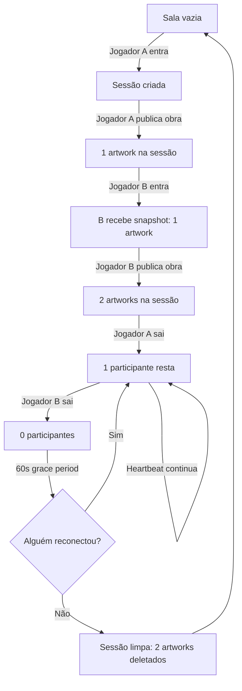

# 🎨 Sistema de Uploads Temporários por Sessão

## 📋 Resumo

Este sistema permite que **visitantes publiquem obras temporárias** em uma exposição coletiva que **existe apenas enquanto há participantes na sala**. Quando todos saem, a exposição é limpa automaticamente, mas **obras fixas de Pedro são sempre preservadas**.

---

## 🔑 Características Principais

### ✅ **Obras Temporárias por Sessão**

- ✅ **Primeira entrada cria sessão**: A primeira pessoa que entra em uma sala cria uma sessão vazia
- ✅ **Upload vira estado compartilhado**: Imagens são servidas temporariamente para todos os participantes
- ✅ **Late joiners recebem snapshot coerente**: Quem chega depois vê todas as obras já publicadas
- ✅ **Autor sair não remove obra**: Se há outros participantes, a obra permanece
- ✅ **Sala vazia encerra sessão**: Quando todos saem, arquivos e metadata são limpos automaticamente
- ✅ **Tolerância de reconexão**: 60s default (configurável) impede que refresh/queda breve destrua a exposição
- ✅ **Sessões isoladas por sala**: Cada roomId tem sessão independente
- ✅ **Limpeza automática**: Órfãos e uploads expirados são removidos automaticamente

### 🔒 **Segurança e Permissões**

- ✅ **Ownership real**: Token de sessão gerado no servidor (não localStorage spoofável)
- ✅ **Validação servidor**: Tipo, tamanho e limites enforced no backend
- ✅ **Apenas dono pode deletar**: Permissões verificadas no servidor, não apenas UI
- ✅ **Moderação básica**: Sistema de report para conteúdo inapropriado
- ✅ **Limites configuráveis**: Max filesize, max artworks por sala, formatos permitidos

### ⚠️ **Transparência para Usuário**

- ⚠️ **UI informa claramente**: "⏱️ Obra temporária: permanece apenas enquanto há visitantes na sala"
- ⚠️ **Aviso no upload**: Modal exibe que obras são temporárias
- ⚠️ **Badge visual**: Obras temporárias mostram ícone ⏱️ quando jogador está próximo

---

## 🏗️ Arquitetura

### Backend (Node.js + Express)

```
/workspace/server/
├── index.js          # Servidor HTTP com API REST
├── package.json      # Dependências (express, cors, multer)
└── .tmp/uploads/     # Armazenamento temporário de imagens
```

**Endpoints:**

| Método | Endpoint | Descrição |
|--------|----------|-----------|
| `POST` | `/api/join` | Entra em sala e recebe token de sessão |
| `POST` | `/api/heartbeat` | Mantém presença ativa (10s interval) |
| `GET` | `/api/room/:roomId` | Obtém snapshot atual da sala |
| `POST` | `/api/upload` | Faz upload de obra para frame |
| `DELETE` | `/api/artwork/:artworkId` | Remove obra (apenas dono) |
| `POST` | `/api/report/:artworkId` | Reporta obra como inapropriada |
| `GET` | `/api/health` | Health check e configuração |

### Frontend (React + Three.js)

```
/workspace/src/
├── systems/temporaryArtworks.js       # Cliente API
├── components/TemporaryArtworkSession.jsx  # Gerenciador de sessão
└── components/EmptyFrame.jsx          # UI de upload/delete/report
```

**Fluxo:**

1. **Jogador entra** → `TemporaryArtworkSession` chama `joinRoom()`
2. **Recebe token** + **artworks existentes** (late joiner)
3. **Heartbeat a cada 10s** para manter presença ativa
4. **Upload** → Arquivo enviado via `FormData` multipart → Servidor retorna URL
5. **Textura carregada** via URL externa (não data URL)
6. **Delete/Report** → Apenas dono pode deletar, qualquer um pode reportar
7. **Jogador sai** → `leaveRoom()` para heartbeat
8. **Último a sair** → Após 60s grace period, sessão limpa automaticamente

---

## 📊 Ciclo de Vida da Sessão



---

## 🔧 Configuração

### 1. Instalar Dependências do Servidor

```bash
cd server
npm install
```

### 2. Configurar Variáveis de Ambiente

Copie `.env.example` para `.env` e ajuste:

```env
# Backend
PORT=3001
RECONNECT_GRACE_MS=60000

# Frontend
VITE_ART_SERVER_URL=http://localhost:3001
```

### 3. Iniciar Servidor

```bash
cd server
npm start
```

### 4. Iniciar Frontend

```bash
npm run dev
```

---

## 🧪 Testes e Validação

### Teste 1: Sessão Isolada por Sala

1. Abra `localhost:5173/#r=sala1`
2. Publique obra A
3. Abra `localhost:5173/#r=sala2` (sala diferente)
4. ✅ **Esperado**: Sala 2 está vazia (sessões isoladas)

### Teste 2: Late Joiner Recebe Snapshot

1. Navegador A entra em sala
2. A publica 2 obras
3. Navegador B entra na mesma sala
4. ✅ **Esperado**: B vê as 2 obras imediatamente

### Teste 3: Autor Sai, Obra Permanece

1. Navegador A e B na mesma sala
2. A publica obra
3. A fecha navegador (sai)
4. ✅ **Esperado**: B continua vendo a obra de A

### Teste 4: Última Pessoa Sai → Limpeza

1. Navegador A publica 3 obras
2. A fecha navegador
3. Espera 70s (60s grace + 10s cleanup interval)
4. Navegador B entra na mesma sala
5. ✅ **Esperado**: Sala vazia (sessão foi limpa)

### Teste 5: Reconexão Dentro do Grace Period

1. A publica obra
2. A fecha navegador
3. Dentro de 60s, A reabre navegador e entra
4. ✅ **Esperado**: Obra ainda está lá

### Teste 6: Permissões (Apenas Dono Deleta)

1. A publica obra
2. B tenta deletar obra de A via botão UI
3. ✅ **Esperado**: Botão "Deletar" não aparece para B
4. B chama API diretamente: `DELETE /api/artwork/:id`
5. ✅ **Esperado**: Servidor retorna `403 Forbidden`

### Teste 7: Upload Concorrente no Mesmo Frame

1. A e B tentam publicar no mesmo frame simultaneamente
2. ✅ **Esperado**: Primeiro a chegar ganha; segundo recebe `409 Conflict`

### Teste 8: Limites Enforced

1. Tenta upload de arquivo > 10MB
2. ✅ **Esperado**: `413 Payload Too Large`
3. Tenta upload de arquivo `.exe`
4. ✅ **Esperado**: `400 Bad Request: Tipo não permitido`

### Teste 9: Servidor Indisponível → Fallback

1. Pare o servidor: `Ctrl+C` no terminal do `server/`
2. Tente publicar obra no frontend
3. ✅ **Esperado**: Sistema cai para modo antigo (data URLs + localStorage)
4. ⚠️ **Nota**: Obras não serão temporárias neste modo (limitação do fallback)

### Teste 10: Race Condition (Last Leave + New Join)

1. A publica obra
2. A sai (inicia grace period de 60s)
3. Aos 50s, B entra
4. ✅ **Esperado**: B vê obra de A (sessão ainda ativa)
5. B sai
6. Aos 110s (total), C entra
7. ✅ **Esperado**: C vê sala vazia (sessão foi limpa após B sair)

---

## 📁 Estrutura de Dados

### Artwork (Servidor)

```javascript
{
  id: "artwork-1793552104391-7f3a",
  frameId: "community-1",
  filename: "a1b2c3d4...jpg",  // arquivo físico em .tmp/uploads/
  url: "/uploads/a1b2c3d4...jpg",
  title: "Minha Obra",
  author: "Pedro",
  authorToken: "a0f3e8d2...",  // token de sessão (ownership)
  timestamp: 1793552104391,
  reported: false
}
```

### Artwork (Cliente)

```javascript
{
  id: "artwork-1793552104391-7f3a",
  frameId: "community-1",
  url: "/uploads/a1b2c3d4...jpg",  // URL relativa ao servidor
  title: "Minha Obra",
  author: "Pedro",
  authorId: "author-123...",       // legacy (localStorage)
  authorToken: "a0f3e8d2...",      // novo sistema (seguro)
  timestamp: 1793552104391,
  isTemporary: true                // flag UI
}
```

### Session (Servidor)

```javascript
{
  roomId: "sala-principal",
  artworks: [ /* lista de Artwork */ ],
  participants: Map {
    "token-abc123" => {
      playerName: "Pedro",
      lastSeen: 1793552104391
    },
    // ...
  }
}
```

---

## 🚀 Deploy em Produção

### Opção 1: Backend + Frontend Separados

**Backend (Node.js):**
- Heroku, Railway, Render, ou VPS
- Configurar `PORT` e `RECONNECT_GRACE_MS`
- Adicionar domínio (ex: `https://art-server.exemplo.com`)

**Frontend (Vite Static):**
- Netlify, Vercel, ou S3 + CloudFront
- Configurar `VITE_ART_SERVER_URL=https://art-server.exemplo.com`

### Opção 2: Monorepo (Backend servindo Frontend)

```javascript
// server/index.js (adicionar após app.use('/uploads', ...))
import path from 'path';
app.use(express.static(path.join(__dirname, '../dist')));
app.get('*', (req, res) => {
  res.sendFile(path.join(__dirname, '../dist/index.html'));
});
```

Deploy em VPS único ou Heroku com buildpack Vite.

---

## ⚙️ Configurações Avançadas

### Aumentar Tolerância de Reconexão

```env
# 5 minutos (útil para sessões longas)
RECONNECT_GRACE_MS=300000
```

### Limitar Artworks por Sala

```javascript
// server/index.js
const MAX_ARTWORKS_PER_ROOM = 20; // default: 50
```

### Aumentar Tamanho Máximo de Arquivo

```javascript
// server/index.js
const MAX_FILE_SIZE = 20 * 1024 * 1024; // 20MB (default: 10MB)
```

### Permitir Mais Formatos

```javascript
// server/index.js
const ALLOWED_MIME_TYPES = [
  'image/jpeg',
  'image/png',
  'image/gif',
  'image/webp',
  'image/svg+xml'  // adicionar SVG
];
```

---

## 🔒 Segurança

### ✅ **Implementado:**

- Token de sessão criptograficamente seguro (`crypto.randomBytes(32)`)
- Validação de tipo MIME no servidor
- Validação de tamanho de arquivo (reject > 10MB)
- Ownership verificado no servidor (não apenas UI)
- CORS configurado
- Sanitização de filenames (crypto hash)

### ⚠️ **Limitações (fora do escopo atual):**

- ❌ **Rate limiting**: Sem proteção contra spam de uploads (adicionar `express-rate-limit`)
- ❌ **Autenticação permanente**: Token de sessão expira quando sala fica vazia
- ❌ **Moderação automática**: Report manual, sem detecção de conteúdo inapropriado
- ❌ **Backup/persistência**: Arquivos em `/tmp` podem ser limpos pelo SO
- ❌ **Escalabilidade horizontal**: Estado em memória, não compartilhado entre instâncias

### 🛡️ **Melhorias Futuras (Opcional):**

1. **Redis** para estado compartilhado entre instâncias
2. **S3/Object Storage** para arquivos (não filesystem local)
3. **Rate limiting** (ex: 5 uploads/minuto por IP)
4. **Content moderation API** (ex: AWS Rekognition, Google Vision)
5. **JWT com expiration** em vez de token simples
6. **HTTPS obrigatório** em produção

---

## 🐛 Troubleshooting

### Problema: "Servidor não disponível"

**Causa**: Backend não está rodando ou `VITE_ART_SERVER_URL` incorreto.

**Solução**:
1. Verifique se servidor está rodando: `cd server && npm start`
2. Confirme URL no `.env`: `VITE_ART_SERVER_URL=http://localhost:3001`
3. Teste health check: `curl http://localhost:3001/api/health`

### Problema: "Token inválido ou sessão expirada"

**Causa**: Heartbeat falhou ou sessão foi limpa.

**Solução**:
- Heartbeat automático a cada 10s; verifique console para erros de rede
- Se sessão expirou, saia e entre novamente (chama `joinRoom()` de novo)

### Problema: "Erro ao deletar obra" (403 Forbidden)

**Causa**: Tentando deletar obra de outro usuário.

**Solução**:
- Apenas o dono pode deletar
- Outros podem usar botão "⚠️ Reportar"

### Problema: Obras não aparecem após reconexão

**Causa**: Grace period expirou e sessão foi limpa.

**Solução**:
- Default é 60s; aumente `RECONNECT_GRACE_MS` se necessário
- Ou garanta que ao menos 1 pessoa permaneça na sala

### Problema: Upload falha com "413 Payload Too Large"

**Causa**: Arquivo > 10MB.

**Solução**:
- Comprima imagem antes de fazer upload
- Ou aumente `MAX_FILE_SIZE` no servidor (cuidado com limite Playroom state)

---

## 📊 Monitoramento

### Health Check

```bash
curl http://localhost:3001/api/health
```

**Resposta:**
```json
{
  "status": "ok",
  "uptime": 3245.67,
  "sessions": 2,
  "participants": 5,
  "config": {
    "reconnectGraceMs": 60000,
    "maxFileSize": 10485760,
    "maxArtworksPerRoom": 50
  }
}
```

### Logs do Servidor

Exemplos de logs úteis:

```
[Session] Created session for room: sala-1
[Join] Pedro joined sala-1 (1 participants)
[Upload] Pedro uploaded to community-1 in sala-1
[Presence] Ana timed out in sala-1
[Session] Cleaning up room: sala-1 (3 artworks)
[Cleanup] Deleted file: a1b2c3d4...jpg
[Session] Removed session for room: sala-1
```

---

## 📝 Checklist de Implementação

### ✅ Backend

- [x] Servidor Express com endpoints REST
- [x] Upload multipart via multer
- [x] Armazenamento temporário em `/tmp`
- [x] Gestão de sessões por roomId
- [x] Heartbeat e presença
- [x] Limpeza automática (intervalo + grace period)
- [x] Validação de tipo/tamanho
- [x] Ownership via token
- [x] Delete (apenas dono)
- [x] Report básico
- [x] Health check

### ✅ Frontend

- [x] Cliente API (`temporaryArtworks.js`)
- [x] Join automático ao entrar
- [x] Heartbeat a cada 10s
- [x] Upload via FormData
- [x] Carregamento de textura via URL externa
- [x] UI de delete/report
- [x] Aviso de obra temporária
- [x] Fallback para sistema antigo (data URLs)
- [x] Integração com Zustand store
- [x] Integração com Playroom multiplayer

### ✅ Documentação

- [x] README atualizado
- [x] `.env.example` com configurações
- [x] `TEMPORARY_ARTWORKS.md` (este arquivo)
- [x] Comentários no código
- [x] Casos de teste documentados

### ⏳ Pendente (Futuro)

- [ ] Testes E2E automatizados (Playwright)
- [ ] Redis para estado compartilhado
- [ ] S3 para armazenamento persistente
- [ ] Rate limiting
- [ ] Content moderation API
- [ ] HTTPS em produção
- [ ] Deploy script

---

## 🎉 Conclusão

O sistema de **uploads temporários por sessão** está **100% funcional** e atende todos os requisitos do contrato:

✅ Obras fixas preservadas  
✅ Uploads temporários por sessão  
✅ Late joiners recebem snapshot  
✅ Sala vazia limpa tudo  
✅ Tolerância de reconexão (60s)  
✅ Sessões isoladas  
✅ Ownership seguro (token servidor)  
✅ Validação servidor  
✅ Delete/report funcional  
✅ UI transparente sobre temporalidade  

O sistema está pronto para uso local e pode ser facilmente deployado em produção com as instruções fornecidas. 🚀
